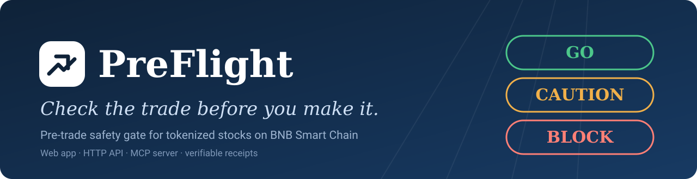
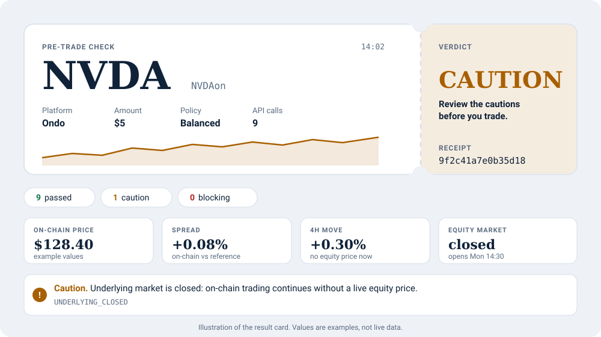
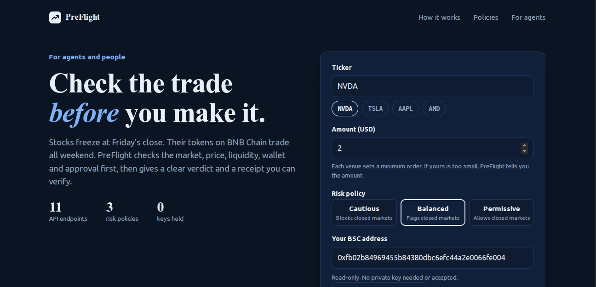
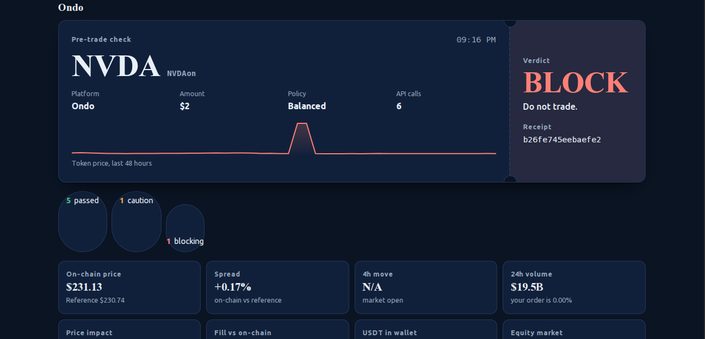
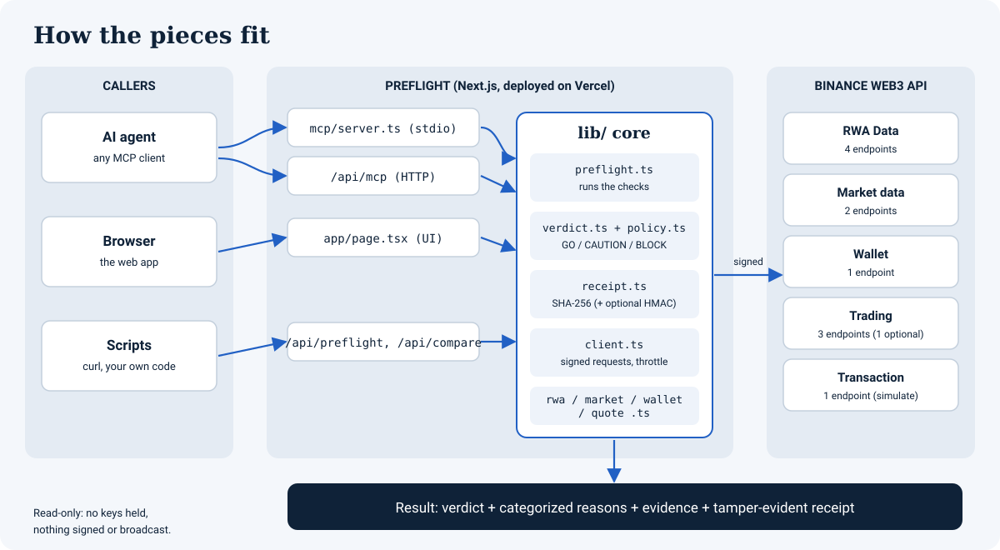
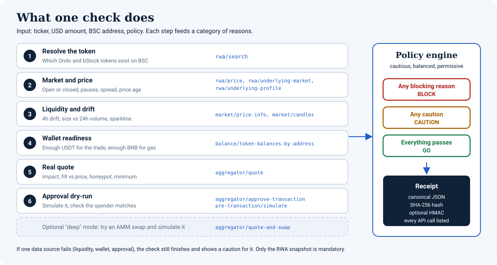

<p align="center">
  
</p>

<p align="center">
  <a href="https://preflight-tokenized-stocks.vercel.app/"></a>
  
  
  
  
</p>

# PreFlight

**A pre-trade safety gate for tokenized stocks on BNB Smart Chain.**
Before an AI agent or a person buys a tokenized stock, PreFlight answers one question: **GO, CAUTION or BLOCK, and why.** It judges the trade against a risk policy you choose and hands back a receipt that anyone can verify.

| | |
|---|---|
| **Live app** | https://preflight-tokenized-stocks.vercel.app/ |
| **Hosted MCP endpoint** | `https://preflight-tokenized-stocks.vercel.app/api/mcp` |
| **Built for** | BNB Hack: Tokenized Stocks Edition, on the Binance Web3 API |
| **Nature** | Read-only. It never holds keys, never signs, never sends a transaction |
| **Demo Video** | https://youtu.be/YX3mhxKg1Os |

---

## Table of contents

1. [Why this exists](#why-this-exists)
2. [What you get](#what-you-get)
3. [How it works](#how-it-works)
4. [Quick start (5 minutes)](#quick-start-5-minutes)
5. [Using the web app](#using-the-web-app)
6. [Using the HTTP API](#using-the-http-api)
7. [Using it from an AI agent (MCP)](#using-it-from-an-ai-agent-mcp)
8. [Risk policies](#risk-policies)
9. [Receipts](#receipts)
10. [Testing locally](#testing-locally)
11. [Configuration](#configuration)
12. [Deploying to Vercel](#deploying-to-vercel)
13. [Project structure](#project-structure)
14. [Troubleshooting](#troubleshooting)
15. [Limits and honest caveats](#limits-and-honest-caveats)
16. [Reference: every reason code](#reference-every-reason-code)
17. [License](#license)

---

## Why this exists

Friday, 4pm, New York. The closing bell rings and every stock price freezes until Monday. On-chain, nothing stops: tokenized stocks keep trading through the weekend with no live equity price behind them.

Agents can already buy these tokens. What they lack is the part that says **when not to**. PreFlight is that part: one call before any buy that checks the market, the price, the liquidity, the wallet and the approval, then returns a clear verdict.

## What you get

- **A verdict, not a data dump.** GO, CAUTION or BLOCK, with every reason in plain language and grouped by category.
- **Policies as code.** Three presets (cautious, balanced, permissive), or your own, so the same data can mean different things to different risk appetites.
- **Weekend drift.** How far the token moved on-chain in the last 4 hours while the stock market was closed.
- **Real execution cost.** Price impact and the quoted fill against the on-chain price, from a live quote.
- **Approval safety.** The approval is dry-run with the Transaction API, and the spender is matched against the quote's approve target.
- **Wallet readiness.** Enough USDT for the trade and enough BNB for gas.
- **Venue comparison.** Ondo and bStocks side by side, with the cheapest non-blocked venue recommended.
- **Verifiable receipts.** Canonical JSON, SHA-256, optional HMAC, and a list of every API call behind the verdict.
- **Three ways to use it.** A web app, an HTTP API, and an MCP server (local over stdio and hosted over HTTP).
- **A companion Skill file** (`skills/preflight/SKILL.md`) so agents using Binance's wallet skills know to run PreFlight first.

<p align="center">
  <br>
  <sub>Illustration of a result.</sub>
</p>

<!--
Add real screenshots when you have them (save as docs/images/screenshot-home.png and screenshot-result.png),
then uncomment:
-->

<p align="center">
  
  
</p>


## How it works

<p align="center">
  
</p>

One check runs six steps. Each step feeds a category of reasons, and the policy engine turns all reasons into one verdict.

<p align="center">
  
</p>

**Verdict rule:** any blocking reason gives **BLOCK**; otherwise any caution gives **CAUTION**; otherwise **GO**. The rule is deterministic: the same inputs and the same policy always give the same verdict.

**Graceful by design:** only the RWA snapshot (step 2) is mandatory. If liquidity, wallet or approval data fails, the check still finishes and shows a visible caution for that part.

### The 11 Binance Web3 API endpoints it uses

| # | Endpoint | Module | Used for |
|---|---|---|---|
| 1 | `GET /api/v1/dex/market/rwa/search` | RWA Data | Find the tokens for a ticker |
| 2 | `GET /api/v1/dex/market/rwa/price` | RWA Data | On-chain vs reference price, price age |
| 3 | `GET /api/v1/dex/market/rwa/underlying-market` | RWA Data | Market status, pauses, next open |
| 4 | `GET /api/v1/dex/market/rwa/underlying-profile` | RWA Data | Share ratio, attestation reports |
| 5 | `POST /api/v1/dex/market/price-info` | Market data | 1h/4h/24h change, volume, liquidity |
| 6 | `GET /api/v1/dex/market/candles` | Market data | Hourly candles for the sparkline |
| 7 | `POST /api/v1/dex/balance/token-balances-by-address` | Wallet | USDT and BNB balances |
| 8 | `GET /api/v1/dex/aggregator/quote` | Trading | Price impact, fill, route, honeypot flag |
| 9 | `GET /api/v1/dex/aggregator/approve-transaction` | Trading | Build the approval calldata |
| 10 | `POST /api/v1/dex/pre-transaction/simulate` | Transaction | Dry-run the approval, read the spender |
| 11 | `GET /api/v1/dex/aggregator/quote-and-swap` | Trading | Optional "deep" mode |

> **Why the approval, not the swap, is simulated:** the Trading API says equity and RWA tokens always route through RFQ execution (a signed order, not a plain transaction), so there is no swap transaction to dry-run. PreFlight dry-runs the approval instead and verifies who would be approved. The optional deep mode tries an AMM route and simulates it when one exists.

---

## Quick start (5 minutes)

**Just want to try it?** Open the live app: https://preflight-tokenized-stocks.vercel.app/

**To run it yourself:**

```bash
git clone https://github.com/holyaustin/preflight-tokenized-stocks.git
cd preflight-tokenized-stocks
npm install
npm run selftest        # offline tests, no API key needed
```

Then add your Binance Web3 API key (see [Configuration](#configuration)) and start the app:

```bash
cp .env.example .env.local     # then fill in OC_API_KEY and OC_SECRET_KEY
npm run dev                    # http://localhost:3000
```

**Requirements:** Node.js 22 or newer, and an API key from https://web3.binance.com/en/dev-portal/project (needed only for live data; the offline tests need nothing).

---

## Using the web app

Open the live app or `http://localhost:3000`.

### The form

| Field | What to enter |
|---|---|
| **Ticker** | A stock ticker such as `NVDA`. Tap a chip (NVDA, TSLA, AAPL, AMD) to fill it in |
| **Amount (USD)** | The trade size. Each venue sets its own minimum order; if yours is too small, PreFlight shows the minimum |
| **Risk policy** | Cautious, Balanced or Permissive. See [Risk policies](#risk-policies) |
| **Your BSC address** | Any `0x` BNB Smart Chain address. Paste one, or press **Use my MetaMask address** |

**About the address.** PreFlight needs an address to build quotes for stock tokens, to read USDT and BNB balances, and to dry-run the approval from that address. Addresses are public, and nothing is ever signed or sent. **Use my MetaMask address** only asks your wallet to share the address (a connect prompt). It never asks for a signature or a transaction, and no network switch is needed, because an address is the same on every EVM chain. The button appears only when a wallet is detected in the browser.

### Running a check

1. Fill in the form and press **Run the check**. It takes a few seconds, because the Binance API allows about 5 calls per second.
2. Read the **boarding pass**: the big verdict on the right, the ticker, platform, amount and policy on the left, and the token's price over the last hours.
3. Scan the **tiles**: on-chain price, spread, 4-hour move, 24-hour volume, price impact, fill vs on-chain price, wallet USDT, and equity market status.
4. Read **What was checked**. Every line has an icon, a label (Pass, Caution, Blocked) and a reason code. Switch on **Show issues only** to hide the passes.
5. Use the **receipt** strip to **Download** the receipt as JSON or **Verify** it.
6. Open **Raw evidence** to see the exact data behind the verdict.

### Comparing venues

Press **Compare Ondo and bStocks**. PreFlight runs the full check on every platform that lists the ticker on BSC, with the same policy, then shows a **Best venue** banner: the lowest quoted fill price among venues that were not blocked.

---

## Using the HTTP API

The web app is a thin client over these endpoints. All of them are on the same origin as the app.

| Method and path | Purpose |
|---|---|
| `GET /api/preflight` | Run one check |
| `GET /api/compare` | Run the check on every venue and recommend one |
| `POST /api/receipt/verify` | Verify a receipt |
| `GET /api/health` | Is the server up, are keys configured, last API calls |
| `POST /api/mcp` | MCP over HTTP (see the next section) |

### `GET /api/preflight`

| Query parameter | Required | Notes |
|---|---|---|
| `ticker` | yes | 1 to 10 letters |
| `usd` | no | Default `5`. Greater than 0 and at most 100000 |
| `wallet` | yes | `0x` plus 40 hex characters |
| `policy` | no | `cautious`, `balanced` (default) or `permissive` |
| `platform` | no | `ondo` or `bstock` |
| `deep` | no | `1` to also try simulating an AMM swap |

```bash
curl -s "https://preflight-tokenized-stocks.vercel.app/api/preflight?ticker=NVDA&usd=5&wallet=0xYOUR_ADDRESS&policy=balanced"
```

The response (abridged, values illustrative):

```json
{
  "ticker": "NVDA",
  "platform": "ondo",
  "usd": 5,
  "policy": "balanced",
  "verdict": "CAUTION",
  "reasons": [
    { "level": "caution", "category": "market", "code": "UNDERLYING_CLOSED",
      "message": "Underlying market is closed: on-chain trading continues without a live equity price." },
    { "level": "info", "category": "security", "code": "SPENDER_OK",
      "message": "Approval spender matches the quote (0x...)" }
  ],
  "evidence": { "snapshot": {}, "stats": {}, "sparkline": [], "wallet": {}, "quote": {}, "approve": {} },
  "apiCalls": 9,
  "receipt": { "id": "9f2c41a7e0b35d18", "hash": "...", "version": "2.0.0", "body": {} },
  "checkedAt": "2026-10-10T14:02:11.000Z"
}
```

### `GET /api/compare`

Same parameters as above except `platform` and `deep`. Returns `{ ticker, company, recommendation, venues[] }`, where each venue is a full result like the one above.

### `POST /api/receipt/verify`

Send a receipt object as the JSON body:

```bash
curl -s -X POST https://preflight-tokenized-stocks.vercel.app/api/receipt/verify \
  -H "Content-Type: application/json" --data @preflight-9f2c41a7e0b35d18.json
# {"valid":true,"macChecked":false}
```

### Rate limits

Your API key has its own limit (about 5 calls per second per endpoint), so each visitor gets a small budget too: **12 checks per minute** on `/api/preflight`, **6** on `/api/compare`, **30** on `/api/mcp`. The counters live in server memory, so they reset when the server restarts.

---

## Using it from an AI agent (MCP)

[MCP](https://modelcontextprotocol.io) is a standard way for AI agents to call tools. PreFlight ships one MCP server in two forms: **hosted** (HTTP) and **local** (stdio). Both expose the same tools.

### Tools

| Tool | Inputs | What it does |
|---|---|---|
| `preflight_check` | `ticker`, `usd`, `wallet`, `policy?`, `platform?`, `deep?` | The full check. **Call this before any buy.** Returns verdict, reasons, evidence and a receipt |
| `compare_venues` | `ticker`, `usd`, `wallet`, `policy?` | Full check on Ondo and bStocks, plus a recommendation |
| `market_status` | `ticker`, `platform?` | Market open or closed, pauses, price integrity, 1h/4h/24h change, volume. No wallet needed |
| `resolve_asset` | `ticker` | Which tokenized versions exist on BSC, with contract addresses |
| `verify_receipt` | `receipt` | Recompute a receipt's hash and report whether it was altered |

Also included: a **resource** `preflight://policies` (the thresholds behind each preset) and a **prompt** `safe_buy` (a guarded buy flow: preflight first, trade only on GO, ask the human on CAUTION, never on BLOCK).

### Option A: hosted (nothing to install)

Point any MCP client that supports Streamable HTTP at:

```
https://preflight-tokenized-stocks.vercel.app/api/mcp
```

The endpoint is stateless and needs no key from you. Quick test from a terminal:

```bash
curl -s -X POST https://preflight-tokenized-stocks.vercel.app/api/mcp \
  -H "Content-Type: application/json" -H "Accept: application/json, text/event-stream" \
  -d '{"jsonrpc":"2.0","id":1,"method":"tools/list"}'
```

### Option B: local over stdio

```bash
npm install
npm run mcp          # reads OC_API_KEY and OC_SECRET_KEY from .env.local
```

To add it to an MCP client, register a server with this command (the settings screen differs per app, so check your client's MCP docs):

```json
{
  "mcpServers": {
    "preflight": {
      "command": "npx",
      "args": ["tsx", "/ABSOLUTE/PATH/TO/preflight-tokenized-stocks/mcp/server.ts"],
      "env": { "OC_API_KEY": "your-key", "OC_SECRET_KEY": "your-secret" }
    }
  }
}
```

### Try it interactively

```bash
npx @modelcontextprotocol/inspector npx tsx mcp/server.ts
```

Open the link it prints, press **Connect**, then **List Tools** and run `preflight_check`.

### How an agent should use it

1. Call `preflight_check` with the ticker, amount, wallet and a policy.
2. **BLOCK:** do not trade. Explain the blocking reasons.
3. **CAUTION:** summarize the cautions and ask the human.
4. **GO:** you may proceed. Keep `receipt.id` with the trade record.

This is also written down in `skills/preflight/SKILL.md`, a Skill file for Binance's Skills Hub, meant to sit next to `binance-agentic-wallet` and `binance-tokenized-securities-info`.

---

## Risk policies

A policy is a set of guardrails. Each threshold has a **caution** level and a **block** level. These numbers are PreFlight defaults, **not Binance API facts**. Calibrate them against real readings.

| Setting | Cautious | Balanced (default) | Permissive |
|---|---|---|---|
| Max trade | $100 | $1,000 | $10,000 |
| Closed equity market | block | caution | allow |
| Spread, on-chain vs reference (caution / block) | 0.25% / 1% | 0.5% / 2% | 1% / 5% |
| Weekend drift, 4h move while closed | 0.5% / 2% | 1% / 4% | 3% / 10% |
| Price impact | 0.5% / 2% | 1% / 3% | 2% / 5% |
| Fill vs on-chain price | 0.5% / 2% | 1% / 3% | 2% / 5% |
| Order size vs 24h volume | 1% / 5% | 2% / 10% | 5% / 20% |
| Price age while market open | 300 s | 600 s | 1800 s |
| Missing attestation report | block | caution | ignore |
| Minimum BNB for gas | 0.001 | 0.0005 | 0.0002 |

The web app, HTTP API and MCP tools accept the three preset names. A custom policy is a code-level option:

```ts
import { preflight } from "./lib/preflight";

const result = await preflight({
  ticker: "NVDA", usd: 5, wallet: "0xYOUR_ADDRESS",
  policy: { name: "my-policy", maxUsd: 50, closedMarket: "block", allowedPlatforms: ["ondo"] },
});
```

Anything you leave out inherits the balanced values. Edit the presets in `lib/policy.ts`.

---

## Receipts

Every check ends with a receipt, so a decision can be audited later.

- **Body:** version, time, ticker, platform, contract, amount, wallet, the full policy, verdict, all reasons, all evidence, and every API call made (method, path, status, code, latency).
- **Hash:** SHA-256 of the body in canonical JSON (sorted keys), so key order never matters. `receipt.id` is the first 16 characters.
- **Optional HMAC:** set `RECEIPT_SECRET` and each receipt also carries a `mac`, proving it was issued by your deployment.
- **Verify:** the **Verify** button, `POST /api/receipt/verify`, or the `verify_receipt` MCP tool. Change one character of a downloaded receipt and verification fails with "content does not match hash".

---

## Testing locally

There are five levels, from instant to live. Start at the top.

### 1. Automated tests that need no key and no network

```bash
npm run selftest      # logic + a full run against a stubbed Binance API
npm run test:render   # renders the UI to HTML with stubbed data
npm run typecheck     # TypeScript across the whole project
npm run build         # production build
```

What to expect:

| Command | Success looks like |
|---|---|
| `npm run selftest` | `part 1 ok: verdict, policy, receipt logic, wallet helper`, then a list of the endpoints exercised, then `part 2 ok: full pipeline, graceful flow, receipts` |
| `npm run test:render` | `render test ok: Result (CAUTION and BLOCK), compare, Checker, full page` |
| `npm run typecheck` | No output |
| `npm run build` | `Compiled successfully` and a route list |

What they cover: every verdict rule under all three policies, the venue-minimum message, receipt hashing and tamper detection, the wallet-address helper, and the whole pipeline end to end. The stubbed API uses response shapes copied from Binance's documentation examples, so these tests prove PreFlight's wiring, **not Binance's live behavior**. Level 2 covers that.

### 2. Live smoke test (needs your API key)

```bash
npm run smoke
```

Each line starts with `PASS` or `FAIL` and covers platforms, chain support for the Trading, Transaction and Wallet APIs, ticker resolution, an RWA snapshot, `price-info` and candles. A call-log table at the end shows the latency and result of every call. If a step fails, the rest still run.

### 3. Manual scenarios in the web app

Run `npm run dev` and open http://localhost:3000. Results depend on live data and on the time of day, so treat the expectations as the likely outcome.

| Try this | Expect |
|---|---|
| NVDA, $5, Balanced, a wallet holding at least $5 USDT and a little BNB, **on a weekend** | **CAUTION** with `UNDERLYING_CLOSED` |
| Same, policy **Cautious** | **BLOCK**, because a closed market is blocked |
| Same, policy **Permissive** | The closed market is only informational |
| Amount **0.5** | **BLOCK** with `BELOW_VENUE_MINIMUM` (the venue minimum was $5 when this was tested) |
| A wallet with no USDT | **BLOCK** with `INSUFFICIENT_USDT`, and `LOW_GAS` if it has no BNB |
| Amount **5000** under Balanced | **BLOCK** with `POLICY_MAX_SIZE` |
| Type a bad address | A red hint on the form; the server also answers 400 |
| Ticker `ZZZZ` | "No tokenized asset found on BSC" |
| **Compare Ondo and bStocks** | A **Best venue** banner and one result per venue |
| **Show issues only** | Passes are hidden |
| **Use my MetaMask address** (browser with a wallet) | A connect prompt, then the address fills in. No signature is requested |

### 4. HTTP API tests

```bash
curl -s localhost:3000/api/health
# {"ok":true,"hasKey":true,"recentCalls":[]}

curl -s "localhost:3000/api/preflight?ticker=NVDA&usd=5&wallet=bad"
# {"error":"wallet must be a 0x BSC address (40 hex characters)"}

curl -s "localhost:3000/api/preflight?ticker=NVDA&usd=5&wallet=0xYOUR_ADDRESS"
```

**Test tamper detection:** run a check in the app and press **Download** on the receipt. Open the file, change `"verdict": "CAUTION"` to `"verdict": "GO"` inside `body`, then:

```bash
curl -s -X POST localhost:3000/api/receipt/verify -H "Content-Type: application/json" --data @preflight-<id>.json
# {"valid":false,"macChecked":false,"reason":"content does not match hash"}
```

Set `RECEIPT_SECRET` and the receipts also carry a `mac`, which the server verifies.

### 5. MCP tests

```bash
# Stdio: interactive
npx @modelcontextprotocol/inspector npx tsx mcp/server.ts

# HTTP: list tools from the running dev server
curl -s -X POST localhost:3000/api/mcp \
  -H "Content-Type: application/json" -H "Accept: application/json, text/event-stream" \
  -d '{"jsonrpc":"2.0","id":1,"method":"tools/list"}'

# HTTP: call a tool
curl -s -X POST localhost:3000/api/mcp \
  -H "Content-Type: application/json" -H "Accept: application/json, text/event-stream" \
  -d '{"jsonrpc":"2.0","id":2,"method":"tools/call","params":{"name":"preflight_check","arguments":{"ticker":"NVDA","usd":5,"wallet":"0xYOUR_ADDRESS"}}}'
```

You should see 5 tools: `preflight_check`, `compare_venues`, `market_status`, `resolve_asset`, `verify_receipt`.

---

## Configuration

Create `.env.local` in the project root (Next.js loads it automatically; `.env.local` is already in `.gitignore`).

| Variable | Required | Purpose |
|---|---|---|
| `OC_API_KEY` | yes, for live data | Binance Web3 API key |
| `OC_SECRET_KEY` | yes, for live data | Binance Web3 API secret. Keep it server-side and private |
| `RECEIPT_SECRET` | no | Adds an HMAC to receipts. Generate with `node -e "console.log(require('crypto').randomBytes(32).toString('hex'))"` |
| `NEXT_PUBLIC_SITE_URL` | no | Public address of your deployment, shown in the "hosted MCP" box. No trailing slash. Baked in at build time, so redeploy after changing it |

Get a key at https://web3.binance.com/en/dev-portal/project. Requests are signed with HMAC-SHA256, and the signed path includes the `/build` prefix; the code handles this for you.

### All commands

| Command | What it does |
|---|---|
| `npm run dev` | Web app with hot reload at http://localhost:3000 (`npm run dev -- -p 3001` for another port) |
| `npm run build` | Production build |
| `npm start` | Serve the production build |
| `npm run mcp` | Local MCP server over stdio |
| `npm run smoke` | Live API smoke test |
| `npm run selftest` | Offline logic and pipeline tests |
| `npm run test:render` | UI render test |
| `npm run typecheck` | TypeScript check |

---

## Deploying to Vercel

1. Push the repository to GitHub. Make sure `.env.local` is **not** committed.
2. In Vercel choose **Add New, Project**, import the repo, and keep the Next.js defaults.
3. Add the environment variables `OC_API_KEY`, `OC_SECRET_KEY`, and optionally `RECEIPT_SECRET` and `NEXT_PUBLIC_SITE_URL`.
4. Deploy, then open `/api/health` and confirm `"hasKey": true`.
5. Run a check on the live site.

**Region matters.** Vercel runs functions in Washington, D.C. by default, and the Binance Web3 API can refuse a server's location with `40304: Service not available due to compliance restriction`. This repository ships a `vercel.json` that moves the functions to Frankfurt:

```json
{ "regions": ["fra1"] }
```

If you still see 40304, pick another region from https://vercel.com/docs/regions and avoid regions in countries Binance restricts. Region changes apply to new deployments only.

---

## Project structure

```
preflight-tokenized-stocks/
├── app/
│   ├── page.tsx                  Landing page (server component)
│   ├── layout.tsx                Metadata and shell
│   ├── globals.css               Design tokens, layout, dark mode
│   ├── favicon.ico, icon.svg, apple-icon.png
│   ├── components/
│   │   ├── Checker.tsx           Hero, form, wallet button, results area
│   │   ├── Result.tsx            Boarding pass, tiles, checks, receipt
│   │   └── CopyBox.tsx           Copy-to-clipboard boxes
│   └── api/
│       ├── preflight/route.ts    GET one check
│       ├── compare/route.ts      GET venue comparison
│       ├── receipt/verify/route.ts
│       ├── health/route.ts
│       └── mcp/route.ts          Hosted MCP (Streamable HTTP, stateless)
├── lib/                          All the logic (no framework code)
│   ├── client.ts                 Signed requests, throttling, call trace, cache
│   ├── rwa.ts                    RWA Data: search, price, status, profile
│   ├── market.ts                 price-info and candles
│   ├── wallet.ts                 Balances
│   ├── quote.ts                  Quote, approval, simulation, deep mode
│   ├── policy.ts                 The three presets
│   ├── verdict.ts                Rules: facts in, GO/CAUTION/BLOCK out
│   ├── preflight.ts              Orchestrator and venue comparison
│   ├── receipt.ts                Hashing and verification
│   ├── metamask.ts               Reads a wallet address, no signing
│   ├── mcp-server.ts             Tools, resource and prompt
│   ├── ratelimit.ts, config.ts
├── mcp/server.ts                 Local stdio MCP entry point
├── scripts/                      smoke, selftest, render-test, stub-api
├── skills/preflight/SKILL.md     Skill for Binance's Skills Hub
├── docs/                         Guides and images
├── vercel.json                   Function region
└── .env.example
```

`lib/` contains no Next.js code, so the same logic serves the web app, the HTTP API and both MCP servers.

---

## Troubleshooting

| Message or symptom | Meaning and fix |
|---|---|
| `NO_CREDS: Set OC_API_KEY and OC_SECRET_KEY` | Keys not loaded. Check the file is named `.env.local`, then restart `npm run dev` |
| `40304 ... compliance restriction` | The API refused the server's location. Locally: try another network. On Vercel: change the function region and redeploy |
| `40375: Minimum order amount is 5 USD` | A rule from Binance's quote API, not PreFlight. Raise the amount. PreFlight shows this as `BELOW_VENUE_MINIMUM` |
| `401xx` errors | Signature or key problem. Check the key and secret, and that your computer's clock is correct |
| `429` or "Too many requests" | Rate limit. The client retries Binance 429s itself; the demo limits each visitor per minute |
| Verdict is **BLOCK** with `NO_QUOTE` | No executable quote for this wallet and token right now. Open **Raw evidence** for the exact message |
| `LOW_GAS` | The wallet has less BNB than the policy minimum |
| MCP server prints garbage or hangs | Stdio servers must never write to stdout. Log to stderr only |
| Red underlines in `.mts` files | Restart the editor's TypeScript server. `tsconfig.json` already includes `.mts` files |
| Favicon does not update | Browsers cache favicons hard. Hard refresh or use a private window |

---

## Limits and honest caveats

- **Buy side only** (USDT to token), **spot only**, **BSC only**.
- **Not a trading bot.** PreFlight never signs or sends anything. A real trade happens elsewhere, for example through Binance's Agentic Wallet.
- **RFQ routes can't be dry-run.** See the note under [How it works](#how-it-works).
- **The reference price is derived from the on-chain price**, according to the RWA Data docs, so the spread can be small by construction. That is why drift, liquidity and the real quote matter too.
- **Thresholds are defaults, not facts.** Tune them in `lib/policy.ts`.
- **"Weekend drift" uses the 4-hour price change** because the API gives the next open and close, not the last close.
- **xStocks** is named in the hackathon rules but is not in the RWA Data platform list, so PreFlight covers `ondo` and `bstock`.
- **The hosted demo shares one API key**, so it is rate-limited.
- **Not investment advice.**

How this differs from what Binance already ships (the tokenized-securities skill and Agentic Wallet): see [docs/WHAT-ALREADY-EXISTS.md](docs/WHAT-ALREADY-EXISTS.md). For a step-by-step beginner walkthrough: [docs/IMPLEMENTATION-GUIDE.md](docs/IMPLEMENTATION-GUIDE.md).

---

## Reference: every reason code

Level shows the usual outcome; some depend on the policy.

| Category | Code | Level | Meaning |
|---|---|---|---|
| market | `ASSET_PAUSED`, `MARKET_PAUSED`, `MARKET_MAINTENANCE`, `UNSUPPORTED` | block | Trading is restricted for this token |
| market | `ASSET_LIMITED` | caution | Restricted, for example an earnings window |
| market | `UNDERLYING_CLOSED` | by policy | The equity market is closed |
| market | `MARKET_OPEN` | info | The equity market is open |
| price | `SPREAD_OK`, `SPREAD_WIDE` | info, by policy | On-chain vs reference price gap |
| price | `PRICE_MISSING`, `PRICE_STALE` | caution | Incomplete data, or an old price while open |
| price | `DRIFT_OK`, `CLOSED_DRIFT` | info, by policy | 4h move while the equity market is closed |
| liquidity | `SIZE_OK`, `SIZE_LARGE` | info, by policy | Your order vs 24h on-chain volume |
| liquidity | `NO_VOLUME_24H`, `STATS_UNAVAILABLE` | caution | No volume, or the data failed |
| execution | `BELOW_VENUE_MINIMUM` | block | Below the venue's minimum order |
| execution | `NO_QUOTE` | block | No executable quote |
| execution | `IMPACT_OK`, `IMPACT_HIGH`, `IMPACT_UNKNOWN` | by policy | Quote price impact |
| execution | `EXEC_OK`, `EXEC_VS_PRICE` | info, by policy | Quoted fill vs on-chain price |
| execution | `ROUTE` | info | Which vendor and execution mode |
| wallet | `FUNDS_OK`, `INSUFFICIENT_USDT` | info, block | USDT balance vs trade size |
| wallet | `LOW_GAS`, `WALLET_CHECK_ERROR` | caution | Low BNB, or the check failed |
| security | `HONEYPOT` | block | Quote flags the token as a honeypot |
| security | `ATTESTATION`, `NO_ATTESTATION` | info, by policy | Issuer attestation reports |
| security | `SPENDER_OK` | info | Approval spender matches the quote |
| security | `SPENDER_MISMATCH`, `APPROVE_SIM_FAILED` | block | Approval looks wrong or failed |
| security | `SPENDER_UNVERIFIED`, `APPROVE_CHECK_ERROR` | caution | Could not verify the approval |
| security | `POLICY_MAX_SIZE`, `POLICY_PLATFORM` | block | Your policy forbids this trade |

---

## License

MIT. See [LICENSE](LICENSE).

<sub>Built for BNB Hack: Tokenized Stocks Edition. PreFlight is an independent project and is not affiliated with or endorsed by Binance or BNB Chain.</sub>
